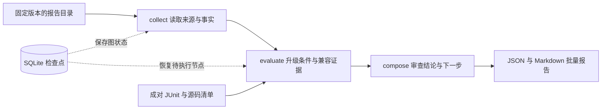

# 可恢复的依赖升级审查工作台

面向维护者收集齐扫描、解析和测试结果之后的审查环节：把散落的证据合成一份可复查的升级报告，并在进程退出后继续未完成的步骤。入口为[review_workbench.py](../agent_lab/review_workbench.py)，使用实际 LangGraph 1.2.24 与 SQLite Checkpointer 3.1.3；无需模型权重、API key 或 GPU。



LangGraph负责节点状态与恢复；应用负责输入绑定、项目/锁文件归属、测试集合一致性和报告内容。[LangGraph持久化说明](https://docs.langchain.com/oss/python/langgraph/persistence)区分持久检查点与仅在内存保存的状态。本应用在受支持的本机文件系统保存SQLite，不把它宣传为多租户托管服务。

## 使用

在已按项目锁文件安装依赖的服务器上，从仓库根目录执行：

```sh
python -m agent_lab.review_workbench \
  --root evidence/dependency-upgrade/corpus \
  --manifest evidence/dependency-upgrade/corpus/catalog.json \
  --compatibility-manifest examples/dependency-workbench/compatibility.json \
  --run-dir /tmp/agentlab-dependency-review-001
```

再次执行相同命令恢复同一个任务。`--report fastmcp_2_12_4`可只选择一个项目，多次传入可选择多个；默认处理目录中全部报告。目录契约支持1–32份报告，不局限于本例的两个项目。源码、报告选择或兼容证据改变后，使用新的run-dir，避免混用历史检查点。

输出包含`summary.md`、`summary.json`、`reviews/<报告ID>.md/json`和本机SQLite状态。单项报告给出目标版本变化、八项审查条件、剩余受影响解析项、兼容测试范围和后续动作；每个结论带固定报告来源及哈希。没有兼容测试记录时，只能进入“待运行范围测试”，不会自动升级为“测试通过”。

本轮工作台读取与MCP服务相同的`EvidenceCatalog`后端，没有发起新的MCP网络会话。既有MCP／LlamaIndex FunctionAgent及真实模型结果见[依赖升级Agent](dependency-upgrade.md)；这里新增的是可恢复的确定性证据工作流，不是新的模型自主维护成绩。

## 三个实际输入

| 历史项目快照 | 工作台结论 | 依据 |
| --- | --- | --- |
| Browser Use 1.0.8 | `blocked` | Pillow精确声明未改变，目标版本未升级；保留2个受影响registry resolutions |
| FastMCP 2.12.4 | `scoped_tests_passed` | Authlib1.6.1→1.9.10的扫描/解析条件满足；对应源码与锁文件的同一批279项鉴权测试原始/候选均通过，仍有16个受影响registry resolutions |

| LightRAG 1.5.8 | `scoped_tests_passed` | 可选evaluation的RAGAS0.4.3→0.4.4；新冻结库扫描，发布版同一组21项测试均通过，仍有17个受影响registry resolutions |

第三个案例另对实际PR基线主线重新配对验证21项，并通过全文件pre-commit；[新案例与正式PR](lightrag-dependency-upgrade.md)记录范围。新案例用11月24日数据库，旧两例保留原11月23日快照，不跨库比较总数。目录构造器显式 `--expected-count 1` 支持单项输入，原默认2保留；工作台读取目录原已支持1–32份。

工作台核对原始／候选JUnit的实际测试ID、失败/错误/跳过状态，验证源码清单只有uv.lock变化，并把两个锁文件哈希与扫描报告绑定。旧279项测试结果来自[之前实际运行的兼容性实验](dependency-upgrade-compatibility.md)，工作台没有重跑这些历史上游测试或历史扫描；新增LightRAG扫描与测试单列记录。样例反映固定历史版本，不是项目当前部署情况或发布审批。

## 本轮验证

服务器12项测试通过，覆盖两个实际报告、完成后复用、持久读取后恢复、错误项目/提交、篡改证据、不同测试ID、修改测试源码、手改报告冲突、输入变更、无身份旧状态及跳过项。另有独立跨进程场景：两个collect节点持久化后，对该子进程发送SIGKILL，再由新的Python进程恢复；禁止再次读取已完成报告，最终四份单项报告和批次Markdown与正常路径字节相同。

该强杀场景位于已提交节点边界，不证明活跃SQLite写入中断或整机断电的行为。输入来自操作者指定的可信目录与兼容清单；本工具不执行清单命令，也不自动编辑仓库、提交PR或部署。已有完成报告若被人修改，会报告冲突并保留内容。

本轮新模型调用0、GPU使用0；每阶段2核CPU/nice19，内存与归属子进程受监督。记录和实际示例见[完整证据](../evidence/dependency-workbench/README.md)。
