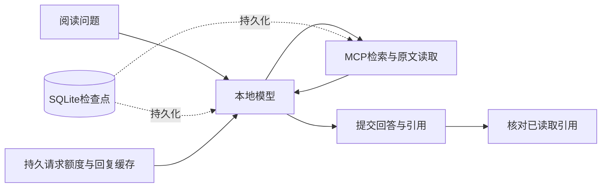

# 带论文出处的本地阅读助手

在已验证的全文检索服务上增加实际模型工具循环：由LangGraph持久化状态，模型通过MCP查找和读取论文页，最后提交回答或说明资料不足。原检索服务继续返回原文，新增助手层负责生成文字。



## 用途与运行

适用于已有可信资料库中的方法解释、跨论文比较，以及资料缺失时明确指出无法据库回答。[安装和启动](../extras/research-assistant/README.md)包含独立CPU依赖环境、0.2.0检索wheel、MCP服务、外部本地模型服务和助手CLI；[全文导入](paper-library.md)负责按页准备资料。助手不会下载、训练或隐式启动模型，也不会连接付费云端。

```sh
extras/research-assistant/.venv/bin/python -m agent_lab.research_assistant \
  --question '解释库中论文的方法差异，并引用实际读过的来源。' \
  --run-dir /tmp/research-question-new \
  --mcp-url http://127.0.0.1:18863/mcp \
  --model-url http://127.0.0.1:18864/v1 \
  --model agentlab-research-qwen3-4b-cpu \
  --model-fingerprint '<已验证的模型文件SHA256>' \
  --max-turns 6 --max-output-tokens 256 --request-seconds 180
```

输出包含模型生成的文字、读取过的引用ID、原始论文哈希和物理页码，以及持久请求额度摘要。使用相同命令恢复已提交节点或读取完成结果；模型声明、问题、资料版本、端点或代码变化要求新建run-dir。SQLite与活动请求账本放在本机支持的文件系统中。

运行停止后，可关闭模型和MCP服务，使用[阅读报告导出](research-reading-report.md)批量整理已有回答、页引用和未完成原因，生成[这样的阅读记录](../examples/research-reports/reading-report.md)。导出不恢复图或调用模型，也不会补写未完成的答案。

## 模型与证据之间的接口

`list_papers`按原PDF合并页来源，避免把32个页条目都塞给模型；`find_passages`从真实MCP检索返回最多两个候选及短引用别名。`read_passage`按该别名调用MCP回读精确片段，并核对来源版本和内容。短别名只在本次任务内有效，最终导出时展开为完整来源信息。

查阅阶段由模型选择工具，`submit_answer`必须作为该轮唯一工具，并引用此前轮次已读取的条目。终态格式由应用约束：若已查阅资料却返回自由文本，或到达最后一个可用轮次，最多请求一次与最终函数参数相同的JSON Schema输出，关闭这一步的工具选择。这个步骤仍占原有调用额度，状态、陈述和引用由模型生成；自由文本本身不会被自动采纳或补上引用。截断结果、来源变化、额度耗尽或无效引用仍保留明确状态。无法找到所需资料时，可在检查资料覆盖后提交`insufficient_evidence`，不据模型记忆补出缺失数字。

`submitted`只表示完成提交工具的结构与引用读取契约；`supported`是模型选择的状态。`semantic_entailment_checked=false`明确表示应用没有自动证明文字陈述被原文蕴含。引用确实存在、确实读过，与文字解释是否正确是两项不同的检查；生成结果仍需结合所指页面评估。

实测的本地服务在指定最终函数时，有时会把参数JSON放在`content`而非`tool_calls`，也可能仍返回普通文本。因此最终步骤使用[固定后端支持的JSON Schema约束](https://github.com/ggml-org/llama.cpp/blob/4783b1145c7073bb809f4c282ff4853cbfe42954/tools/server/README.md#post-v1chatcompletions-openai-compatible-chat-completions-api)，不依赖指定工具名称来保证结构。适配器仅在这一次受约束请求且正常结束时读取完整、无重复键、字段完全匹配的参数对象，再送入同一个引用校验器；输出标记`final_transport=schema_arguments_content`。普通自由文本、非指定轮次的JSON、截断、额外字段和未知引用都不会被直接采纳。私有回复缓存保留原始服务响应，适配后的参数不会被冒充为原生工具调用。

## 计算与恢复

模型请求在发送前写入持久额度账本，限制请求次数与序列化字节；失败、未知和超时尝试继续占用额度，网络层不自动重试、不使用环境代理、不跟随重定向。完整回复先写入带请求哈希的私有缓存，再进入图检查点；恢复同一请求时可复用已保存回复。

检查点覆盖已提交节点边界。工具请求若在节点提交前中断，恢复时可能重新查询，因此不提供任意中断下工具只执行一次的保证。助手的生成额度也不代替检索服务的嵌入额度；本轮验证为两个计算环节分别设置独立限制和账本。

## 验证范围

当前16项服务器工程控制已通过，使用真实LangGraph与AsyncSqliteSaver、脚本化模型和资料夹具，覆盖完整工具循环、错误/未读引用、资料不足、无引用文本、来源变化、已保存回复复用、跨连接检查点恢复、请求截止时间和终态格式步骤。新增控制核对实际HTTP最终参数Schema、查阅阶段仍由模型选择工具、原始回复保留、参数对象适配及拒收路径。这些工程测试不计为真实模型任务成绩；先前7、8、10、15项是迭代版本，不累计计算。

真实CPU模型验证采用现有固定Qwen3-4B-Instruct-2507量化文件、llama.cpp b12576，以及独立复制的LightRAG/MiniRAG全文索引。三项问题及预期契约事先固定于[输入清单](../examples/research-assistant/tasks.json)，问题之外的预期标签不发送给模型。它们是已知资料上的工作流诊断，不是留出QA集或通用Agent准确率测试。

2026-11-25完成的[最终运行](../evidence/research-assistant/trial-v5.json)使用两个CPU核、GPU为0：

| 工作流问题 | 实际结果 | 生成请求 | 单题耗时 |
| --- | --- | --- | --- |
| 解释LightRAG两层检索 | 已提交，引用读取契约通过 | 6 | 241.489秒 |
| 比较两篇论文的索引方式 | 已提交，两篇PDF的引用读取契约通过 | 6 | 201.224秒 |
| 缺少LS-DETR全文时请求精确消融数字 | 未完成有效提交，达到调用上限 | 6 | 175.250秒 |

合计18份完整回复、0新增未知请求；独立嵌入额度中完成4次查询前向、0文本编码、0未知。首题完成后用同一命令启动新进程，新增生成请求与嵌入调用均为0。推理服务和MCP服务已关闭、私有临时密钥已移除。这里的2/3是固定三项工作流的提交契约结果，不能写成问答准确率。

[来源复核](../evidence/research-assistant/source-review.json)由助手结合提取文本和四个实际PDF页面完成，不是独立人工或盲评。首题的简要定义有LightRAG第4页支持，第8页是补充讨论；比较题的核心描述有LightRAG第3页和MiniRAG第1页支持，但未完整解释图边及文本关联，“简单高效”是论文的定性表述，本项目没有测量对应性能收益。资料缺失题虽选择`insufficient_evidence`，却给出空回答并附无关论文引用，被同一校验器拒收；因此不宣传可靠拒答能力。CPU生成每题约3–4分钟，当前没有低延迟服务或生产部署证据。

[迭代与失败记录](../evidence/research-assistant/README.md)保留首轮超时、缓存版/指定函数版未提交，以及参数适配版仅1/3通过的原始结果。最终JSON Schema步骤解决了结构约束问题，没有替模型补充回答或引用；不同版本不混算为独立任务，也不根据这些非隔离计时比较宣传缓存提速。
