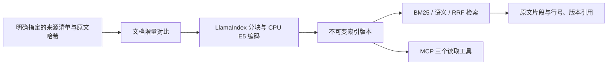

# 带版本引用的研究资料检索服务

面向整理论文资料、项目说明和技术复盘：用实际 LlamaIndex `VectorStoreIndex` 管理文档，使用本地 multilingual-e5-small 在服务器 CPU 上编码，提供关键词、语义与混合检索，以及 MCP 工具接口。返回候选原文和出处，便于接入后续研究助手；当前没有生成答案的模型，也没有完整论文问答成绩。



## 索引与引用

每份来源包含稳定ID、题名、URL、类型和原始UTF-8文件SHA-256。LlamaIndex按256个token分块、重叠32个token；来源元数据不进入嵌入文本。E5按模型要求使用`passage: `和`query: `前缀、注意力掩码均值池化及L2归一化；本应用拒绝超过512token的编码输入，不静默截断。[模型说明](https://huggingface.co/intfloat/multilingual-e5-small)与[文档管理接口](https://developers.llamaindex.ai/python/framework/module_guides/indexing/document_management/)说明底层能力，版本发布、原文校验和引用回读由应用实现。

索引版本绑定来源清单、嵌入配置、分块参数与框架版本。不变资料复用已有向量；更新文档先删除旧节点再编码，删除来源不再参与当前检索。新版本在完整写入后替换`CURRENT.json`，旧版本保留；相同输入再次导入不产生嵌入计算。模型或框架版本变化要求新建存储目录。

每条结果携带`generation:node_id`引用ID、来源哈希、不可变来源URL、字符范围、行号和精确原文。读取历史引用会明确返回`is_current_generation: false`。这些校验用于可信本机资料的完整性与版本区分，不构成针对能改写整个存储目录的攻击者的签名认证。发布中断测试覆盖异常发生在发布前的情况，不宣称断电持久性。

## 使用

现提供[0.3.0独立CPU启动包](../artifacts/agentlab-research-0.3.0-starter.zip)和[wheel](../artifacts/agentlab_research-0.3.0-py3-none-any.whl)。此前已在服务器从冻结锁文件安装全新Linux x86_64 / Python3.11环境，使用torch2.6.0+cpu，不含CUDA运行时，也不依赖维护运行器。0.3.0使用相同冻结依赖，新应用命名空间验证复用既有第三方模块，不是再次清洁安装；[实际安装范围](research-batch.md)另列。LlamaIndex0.14.26、Transformers4.57.6、numpy2.2.6和MCP2.3.0保持声明版本，完整传递依赖见`extras/research-library/uv.lock`；根项目的`uv.lock`仍属于维护运行器。首轮检索诊断使用的旧组合环境作为历史证据保留，没有把新CPU安装当作相同数值环境。

独立安装后可直接导入自己的可信UTF-8资料目录：

```sh
uv sync --project extras/research-library --frozen --no-install-project --no-default-groups
uv pip install --python extras/research-library/.venv/bin/python --no-deps \
  artifacts/agentlab_research-0.3.0-py3-none-any.whl
uv pip check --python extras/research-library/.venv/bin/python
extras/research-library/.venv/bin/agentlab-research check-model --directory /path/to/e5
extras/research-library/.venv/bin/agentlab-research prepare \
  --directory /path/to/docs --output /tmp/my-research-input \
  --base-url 'https://github.com/OWNER/REPO/blob/COMMIT/docs/'
```

`prepare`处理`.md/.txt/.rst/.bib`，保留原始换行、生成稳定路径ID与哈希，0.3.0最多8,192份资料，每份512KiB、总16MiB；PDF另用 `prepare-pdf`，见[完整论文工作流](paper-library.md)，仍有独立的32篇/256页限制。两个命令都不验证调用者声明的来源链接。文本导入的输出目录必须新建且位于输入目录之外。之后用`agentlab-research ingest/search/search-batch/read/serve`；[完整参数与启动说明](../packages/research-library/README.md)。模型权重另外取得，包只提供固定资产哈希；`check-model`仅校验文件并补建缺失清单，不进行推理。使用[PyTorch官方CPU索引](https://pytorch.org/get-started/previous-versions/)与[uv显式索引绑定](https://docs.astral.sh/uv/concepts/indexes/)避免默认拉取CUDA依赖。

原源码模块入口继续兼容。从仓库根目录，在相应依赖环境中执行：

```sh
python -m agent_lab.research_library ingest \
  --manifest /path/to/collection.json --store /tmp/research-library \
  --model-dir /path/to/verified-e5-model

python -m agent_lab.research_library search \
  --query '维护任务中断后怎样恢复？' --mode hybrid --top-k 3 \
  --store /tmp/research-library --model-dir /path/to/verified-e5-model

python -m agent_lab.research_library read \
  --store /tmp/research-library --citation-id '<generation>:<node_id>'

python -m agent_lab.research_mcp \
  --store /tmp/research-library --model-dir /path/to/verified-e5-model --port 18863
```

MCP绑定`127.0.0.1:18863`，接口为`/mcp`，提供`list_sources`、`search_sources`、`read_citation`。工具声明结构化输出，检索可指定来源ID；引用读取不重新编码原文。服务器端串行执行读取/编码，限制请求体大小；这不是远程多租户服务。CLI默认报告本进程编码次数，持久调用账本与硬额度由验证脚本实现，服务本身没有跨重启请求配额。

模型目录需包含固定revision的6份模型/分词文件和`model-manifest.json`，结构见[模型资产清单](../evidence/research-library/model-assets.json)；运行时离线核对每份文件的长度与SHA-256，使用本地权重，不启用远程模型代码。文件清单与[来源示例](../examples/research-library/README.md)公开，权重和索引向量保留私有。

## 实际资料与验证

初始集合包含20份来源、163个节点；更新后仍为20份来源、160个节点。来源是固定版本的项目文档、LS-DETR仓库README及BibTeX；这一历史集合未索引全文论文。新增两篇32页PDF的独立验证见[完整论文流程](paper-library.md)，不把新集合与旧诊断混算。更新过程只对README和新增工作台文档的24个片段编码，其余向量复用；重复导入零编码，删除来源零查询编码，旧引用准确回读。

服务器上10项实际LlamaIndex生命周期测试通过，使用非神经固定测试嵌入；真实E5编码与实际MCP/TCP联调另行执行。首轮MCP因裸`dict`返回声明没有生成结构化输出而失败，102次已完成CPU前向及原索引完整保留；补充明确的`dict[str, Any]`返回类型后，复用同一索引，仅增加1次查询前向完成联调。验证覆盖工具枚举、结构化结果、来源过滤、精确引用、历史引用、无效引用和已删除来源。

| 固定24条已知来源诊断 | 文档覆盖@3 | MRR@3 |
| --- | --- | --- |
| Latin词／中文二元组BM25 | 21/24 | 0.6458 |
| 多语E5语义检索 | 20/24 | 0.7778 |
| RRF混合，k=60 | 20/24 | 0.7569 |

问题和指定来源在排名前冻结；三种方式使用同一B版本、候选窗口24、每份来源只保留首个片段、最终返回3份来源。问题与标注未进入索引。它们是操作者编写的已知来源导航诊断，部分其他文档也可能相关；不是盲测QA，也不能用来宣称混合检索、答案质量或实际Agent任务有提升。

本轮共103次已完成CPU嵌入前向：187个原文片段输入、49个查询输入、零未知；没有生成模型调用或GPU任务。两核CPU/nice19，主实验阶段峰值约1.26GB归属RSS；全部受管作业已结束、无归属子进程残留。原始失败、冻结输入、测试日志和来源哈希见[验证证据](../evidence/research-library/README.md)。

## 独立包的实际验证

全新CPU环境完成冻结同步、构建、wheel安装与依赖检查；离开源码目录、移除PYTHONPATH后确认仅从独立agentlab_research命名空间导入。复验原10项索引生命周期并新增6项目录导入测试，不能与历史10项累计成26项。安装包使用两份真实维护文档完成导入、索引、重复导入零编码、带出处检索、控制台引用回读与实际MCP/TCP联调；原24条排名实验没有重跑。

本轮新增CPU前向6次、原文片段输入12个、查询输入2个，全部已完成、无未知；生成调用与GPU任务为0。模型命令通过已安装CLI的同一main callable执行，观察器只记录/限额，不替换真实E5；原生控制台入口另实测prepare、check-model、read和help。调用账本属于验证工具，服务本身没有新增持久配额。首次同步参数冲突及修复后的安装结果均保留，见[安装与验证证据](../evidence/research-package/README.md)。

## 0.2.0完整论文流程

已在同一检索引擎上接入数字文本PDF，独立验证LightRAG/MiniRAG共32页、148个片段、原PDF与页码/标签、删除整篇后历史引用及实际MCP。新21项源码控制（16既有＋5新增）与58次CPU嵌入前向分别记录，旧排名诊断和旧账本不变。[使用、结果与解析范围](paper-library.md)。旧0.1.0启动包与两份维护文档实验仍保留为历史证据。
